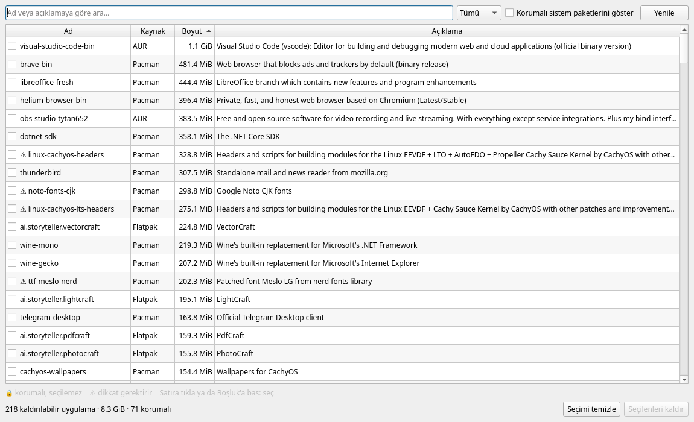

# Kaldır

Arch tabanlı dağıtımlar (Arch, CachyOS, EndeavourOS…) için **güvenli uygulama kaldırıcı**.
Kurulu uygulamaları boyutlarına göre sıralar, seçtiklerini topluca kaldırır ve
sistemi bozabilecek paketlere dokunmaz.

Pacman (resmi depo), AUR ve Flatpak uygulamalarını birlikte gösterir. İki şekilde kullanılır:

- **`kaldir-gui`**: KDE Plasma ile uyumlu grafik arayüz (PyQt6)
- **`kaldir`**: terminalde `fzf` ile çalışan hızlı sürüm



## Neden güvenli?

Rastgele bir paket silmek sistemi açılmaz hale getirebilir. Kaldır bunu birkaç katmanla engeller:

| Katman | Ne yapar |
| :-- | :-- |
| 🔒 **Korumalı paketler** | Çekirdek, önyükleyici, sürücüler, ağ, ses, Plasma masaüstü, giriş ekranı, güvenlik duvarı ve temel sistem paketleri **seçilemez**. |
| 🔍 **Makineye göre algılama** | Çalışan ve yedek çekirdek, giriş ekranı, varsayılan kabuk, açılış imajına bağlı paketler otomatik bulunur. |
| ⚠ **Dikkat uyarıları** | Açılışta çalışan servisler, `.zshrc` içinde kullanılan komutlar ve oturumla başlayan programlar otomatik işaretlenir; onayda ayrıca uyarılır. |
| 🧩 **Bağımlılık kontrolü** | Pacman paketleri `-Rns` ile kaldırılır. Başka bir programın ihtiyaç duyduğu bir paket seçilirse hiçbir şey silinmez ve nedeni okunur şekilde gösterilir (örn. *“vlc → vlc-luajit bunu kullanıyor”*). |
| 🛡 **İkinci kontrol** | Silmeden hemen önce pacman'in tam listesi korumalı listeyle karşılaştırılır. Korumalı bir paket bağımlılık olarak silinecekse “elle kurulmuş” olarak işaretlenip yerinde bırakılır. |
| ✅ **Açık onay** | Neyin silineceği ve ne kadar yer açılacağı gösterilir; varsayılan buton “İptal”dir. Yetki, sistemin kendi penceresiyle (`pkexec`) istenir. |

## Kurulum

Gereksinimler: `python-pyqt6`, `fzf`, `polkit` (çoğu Plasma kurulumunda zaten vardır).

```bash
sudo pacman -S --needed python-pyqt6 fzf polkit
git clone https://github.com/oktayyavuz/kaldir.git
cd kaldir
./install.sh
```

Kurulum yalnızca kullanıcı klasörüne yapılır (`~/.local/bin`), `sudo` gerekmez.
Ardından uygulama menüsünde **Kaldır** olarak görünür.

Kaldırmak için: `./uninstall.sh`

## Kullanım

### Grafik arayüz

```bash
kaldir-gui
```

- Satıra tıkla ya da **Boşluk** tuşuna bas: seç / seçimi kaldır
- `Ctrl+F`: arama
- Kaynağa göre süz: Pacman, AUR, Flatpak
- “Korumalı sistem paketlerini göster” ile korunanları ve nedenlerini gör (üzerine gel)

### Terminal

```bash
kaldir           # fzf ile seç (Tab: çoklu seçim, Enter: kaldır)
kaldir --liste   # yalnızca boyuta göre sıralı listeyi yazdır, hiçbir şey silmez
```

Terminal sürümü de aynı koruma listesini kullanır; korumalı paketler listede görünmez.

### Korumalı paket listesini görmek

```bash
kaldir-gui --korunanlar
```

## Kendi korumaların

Asla silinmesini istemediğin paketleri `~/.config/kaldir/korunan.txt` dosyasına ekle:

```
haruna        # video oynatıcım
brave-bin     # ana tarayıcım
```

Arayüzde **Yenile**'ye bastığında korumalı olarak görünürler.

## Lisans

[MIT](LICENSE) © Oktay Yavuz
